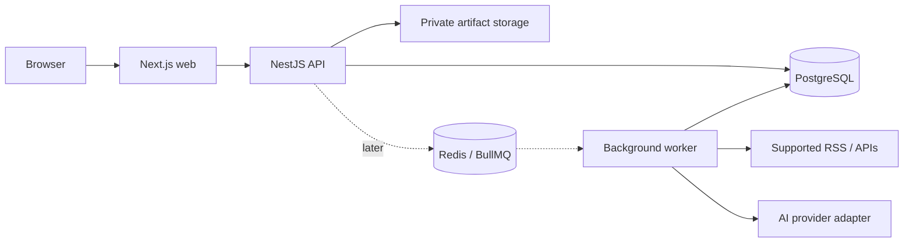

# Architecture and Data Model

## Proposed topology



A modular monolith owns business rules. The web app contains presentation and narrowly scoped server rendering/proxy code, not a second implementation of the domain. Workers reuse backend modules and remain part of the same product and repository.

## Proposed tooling

TypeScript strict mode, pnpm workspaces, Next.js/React, NestJS, PostgreSQL, Prisma, TanStack Query, React Hook Form/Zod, Tailwind/shadcn/ui, Vitest, Playwright, Docker Compose, GitHub Actions. Turborepo becomes useful once shared package build dependencies exist. Versions are selected and pinned at bootstrap; this document does not assert version numbers.

## Repository boundaries

```text
apps/web                 UI and web entry point
apps/api                 HTTP API and domain modules
apps/worker              Added when persistent background work is needed
packages/contracts       Public request/response schemas or generated API client
packages/config          Shared TypeScript/lint configuration
docs                     Product, operational, and architectural documentation
```

Do not expose Prisma models directly as API contracts. Avoid creating generic packages before a real consumer exists.

## Domain modules

Companies, vacancies, applications, career profile, resumes, analytics, sources, operations, and identity. Modules access one another through defined services. Status mutation belongs to Applications; analytics reads the resulting events.

## Logical schema

| Entity | Key data and relationships |
| --- | --- |
| Owner | Private workspace identity and timezone preferences |
| Company | Name, website, normalized identity, owner |
| Source | Directory information and optional connector configuration |
| Vacancy | Company, owner, disposition, availability, normalized eligibility |
| VacancySourceOccurrence | Vacancy, source, external ID, canonical URL, first/last seen |
| VacancySnapshot | Vacancy, source occurrence, original description, captured time, content hash |
| Application | Vacancy, pinned snapshot, status, submission date, submitted resume version, owner |
| ApplicationEvent | Application, type, occurrence/recording times, actor, structured metadata |
| Interview | Application, type, schedule, timezone, status, outcome |
| Note / NextAction | Application, content or due/completion data |
| ProfileFact | Owner, fact category, approved content, revision and provenance |
| ResumeDraft | Owner, structured content, optimistic revision counter |
| ResumeVersion | Immutable content snapshot, parent, target snapshot, provenance |
| Artifact | Private storage key, media type, size, checksum, generating version |
| RequirementSet | Vacancy snapshot, extraction method/version, reviewed requirements |
| TailoringSession | Requirement set, profile revision, base resume, review state |
| Suggestion | Session, referenced facts/requirements, before/after, decision |
| SavedSearch / Match | Criteria version, vacancy, match explanation, seen state |
| OperationRun / Attempt | Logical execution, attempts, failure/recovery history |

Use foreign keys, unique source identifiers, required owner scoping, UTC timestamps, and explicit enums. Compensation uses decimal amounts and currency/period fields. Documents live outside relational rows; structured resume snapshots live in PostgreSQL.

Applications and resume versions cannot be cascade-deleted through company/vacancy removal. Define archival and explicit purge separately. Use transactions for state + event changes, unique constraints for import idempotency, and revision checks for conflicting edits.

Physical migrations, indexes, event payload schemas, and deletion policies are finalized during Phase 0 review. Expected indexes include owner/status/date, application event occurrence time, source/external ID, and operation state/start time.

## API boundaries

Versioned REST API under `/api/v1`, documented through OpenAPI. Common error envelope: `code`, safe `message`, field errors when applicable, and `requestId`. Paginated list endpoints have bounded limits and explicit sorting.

| Boundary | Representative operations |
| --- | --- |
| Companies / vacancies | Create, list/filter, update, archive; capture snapshots |
| Applications | Create draft, submit, transition, timeline, notes, next actions |
| Interviews | Schedule, complete, cancel |
| Profile / resumes | Edit approved profile, draft revision, publish version, export |
| Tailoring | Extract, compare, review suggestion, publish reviewed draft |
| Sources / searches | Configure supported source, run import, evaluate search |
| Analytics | Cohort summaries and milestone counts |
| Operations | List runs, inspect attempts, retry eligible failure, request cancellation |

Submission and transitions are explicit commands rather than unrestricted status field patches. Long-running commands return `202` with a run ID and status URL. Validation and authorization happen on the server even when the UI validates first.

## AI boundary

An internal `AiProvider` exposes structured requirement extraction and grounded change proposals. Provider-specific SDKs are adapter details. Start with a deterministic/manual path and one configured adapter; additional providers can follow the same contract.

Inputs contain approved facts and vacancy text; outputs must pass schema validation and reference valid input IDs. Vacancy text is untrusted data, not instructions. Store provider/model identifier, prompt/schema version, input revision/hash, timing, and safe failure category. Do not store secret keys or raw candidate content in logs.

Provider failures leave drafts untouched. Invalid outputs require review or a bounded retry; the system never silently accepts unsupported claims. AI can be disabled without breaking CRM, editing, export, or manual requirement mapping.

## Security and testing

Use an established session authentication solution; do not design custom authentication crypto. Privately hosted single-owner access still requires authentication. Enforce owner authorization, secure cookie settings, mutation protection appropriate to the session design, server-only secrets, bounded uploads, private downloads, and rate limits for costly operations.

Connectors use configured allowed destinations, bounded timeouts/size, and safe redirect handling. Arbitrary URL ingestion must not access localhost/private network destinations. Sanitize imported markup before rendering. Demo mode uses separate synthetic storage and cannot access real integrations or private documents.

Test domain transitions, analytics denominators, immutable versions, evidence validation, isolation, import idempotency, and retry behavior. Use real PostgreSQL integration tests for constraints/transactions. Playwright verifies the critical user journeys and rendered states. Unit tests should protect behavior, not mirror trivial implementation details.
